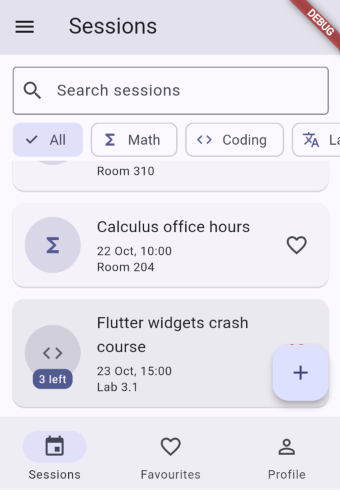
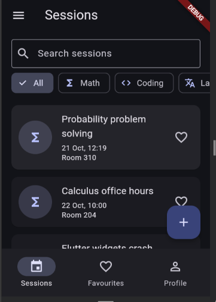
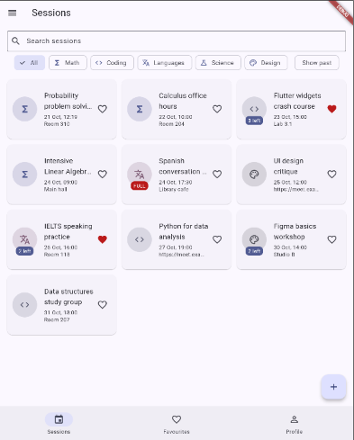

# StudyHub

Mobile Development, Lab 1. A multi-screen Flutter app for **study sessions**:
each session has a title, a subject (math, coding, languages, science, design),
a start time, a place (or a link when it is online), a limit of places and a
list of people who joined. All data lives in memory.

## Screenshots




## Run

```
flutter pub get
flutter run
```

## Decisions

The list of sessions and the profile live in the shell's State, because three tabs, the detail and the form all read or change them, and State is the lowest common ancestor. Tabs receive them as constructor parameters and send changes up through callbacks. The detail takes callbacks through its route arguments because it is a pushed screen that covers the shell, so it has no other way to change the list or to ask the shell to switch to the profile tab. The form returns a value through `pop` instead of calling a callback: the caller awaits the result, ignores `null` (back out) and only then calls `setState`, so a cancelled form changes nothing. The list is a `LayoutBuilder` and not `MediaQuery` because the widget must react to the width it is actually given, not to the width of the whole screen. The `PopScope` compares a snapshot of all form values with the snapshot taken when the form opened, so typing a letter and deleting it again does not count as a change. With week 9's tools I would move the sessions and the profile out of the shell's State into a state-management solution, so that tabs and pushed screens read them directly instead of through long callback chains.
